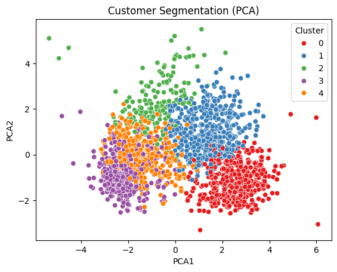

# Customer Segmentation for Targeted Marketing

[](https://github.com/Ampofowaa/CustomerSegmentation_Project/actions/workflows/ci.yaml)
[](LICENSE)

Groups 2,216 retail customers into five stable, plain-English segments so a marketing team can send each group a different campaign instead of one offer for everyone.

**[Live demo](https://customersegmentationproject-ag4tkoe3yjgimkbw73ynsm.streamlit.app/)**: look up any customer's segment or score a CSV of customers. The first load can take up to a minute if the app has been asleep.


<!-- TODO: add a screenshot of the Streamlit app (Single / Batch Prediction tabs) -->

**Problem.** Marketing sends the same campaigns to every customer, and response rates are low: one offer can't fit both a weekly online buyer and someone who hasn't purchased in months. The team needs a few actionable segments, and a way to look up any customer's segment.

**Approach.**
- **Features chosen for the business.** 12 behavioural and demographic features. I excluded past campaign responses: segmenting on them would leak old targeting decisions into future ones.
- **k=5 over the best-scoring k=2.** Two groups can't separate loyalty, win-back and deal-led customers; k=5 surfaces a deal-seeking segment that k=4 hides.
- **PCA to fix collinearity.** The baseline was stable but poorly separated, pointing to overlapping spend features. PCA (8 components, 90% variance) before K-Means improved both.

**Results.** All 2,216 cleaned customers; internal cluster metrics plus seed and bootstrap stability (`models/training_metrics.json`, notebook):

| | Baseline: scaler + K-Means | Final: scaler + PCA + K-Means |
|---|---:|---:|
| Silhouette (higher is better) | 0.180 | **0.200** |
| Davies-Bouldin (lower is better) | 1.825 | **1.688** |
| Seed-stability ARI, mean (5 seeds) | 0.992 | **0.998** |
| Bootstrap-stability ARI, mean (10 resamples) | 0.946 | **0.948** |

## The segments and what to do with them

| Segment | Customers | Profile | Campaign angle |
|---|---:|---|---|
| High-Value Customers (No Children) | 500 | Highest income (~$78k) and spend, heaviest catalog buyers | Loyalty / upsell, catalog-led |
| Premium Teen-Family Shoppers | 520 | High spend, store-focused, teen households | Loyalty / upsell, teen-family angle |
| Deal-Seeking Large Families | 198 | By far the heaviest discount users | Coupon and promotion-led |
| Low-Income Young Families | 544 | Most web visits, few web purchases | Retargeting, fix on-site friction |
| Budget Multi-Child Households | 454 | Low income and spend, largest households, low engagement | [TODO: campaign angle] |

Recency is flat across all five segments, so win-back campaigns should filter inactive customers *within* a segment rather than target one "inactive" group. Full profiles and feature-by-feature reasoning: [docs/methodology.md](docs/methodology.md).

## What's built around the model

- **Python package, not just a notebook:** `src/` holds load → clean → engineer → fit, and the notebook imports it rather than duplicating logic.
- **Serving:** a FastAPI service (`POST /predict` for one customer, `POST /predict/batch` for a CSV) and a Streamlit app for marketers, both containerised with Docker Compose. The app can also run standalone, scoring with the same prediction code in-process, so it can be hosted as a free public demo.
- **Reproducibility:** DVC pipeline, pinned dependencies (`uv.lock`), fixed random seed, and stability checks recorded on every training run.
- **Quality:** pytest unit tests and a GitHub Actions workflow running ruff, black, mypy and pytest on every push.

## Limitations and next steps

- **Modest separation.** A silhouette of 0.200 means segments overlap at the edges, which is typical for customer data. They are reproducible (ARI ≥ 0.99 across seeds) but not sharply isolated.
- **No business validation yet.** The segments are judged on internal metrics and interpretability; there is no campaign lift or A/B result behind them.
- **Single snapshot.** One dataset at one point in time, and age/tenure are computed relative to today, so retraining later shifts the numbers slightly.
- **With another week I would:** build a supervised response-propensity model on the excluded campaign columns, A/B test one campaign per segment, try an ordinal encoding for `Education`, and add API tests.

## Run it

```bash
git clone https://github.com/Ampofowaa/CustomerSegmentation_Project.git
cd CustomerSegmentation_Project
uv sync --all-extras                          # Python 3.12 + uv
uv run python scripts/train.py                # trains and saves the model (not committed)
uv run pytest
uv run uvicorn src.api.main:app --reload      # API docs at http://localhost:8000/docs
```

Or serve both the API and app with `docker compose up -d --build` after training. Full setup, Docker and API reference: [CONTRIBUTING.md](CONTRIBUTING.md).

## Project structure

```
config.py            # features, hyperparameters, segment names
src/                 # data loading, feature engineering, training, prediction
src/api/, src/ui/    # FastAPI service and Streamlit app
notebooks/           # EDA and experiments (imports from src/)
scripts/train.py     # training CLI, wrapped by dvc.yaml
tests/               # pytest unit tests
docker/              # Dockerfiles for API and UI
docs/                # methodology and figures
```

**Tech stack:** Python 3.12, pandas, scikit-learn, FastAPI, Streamlit, Docker, DVC, uv, pytest, GitHub Actions.

## Data and contact

Data: [Customer Personality Analysis](https://www.kaggle.com/datasets/imakash3011/customer-personality-analysis) (Kaggle), 2,240 customers × 29 columns; 2,216 remain after cleaning. Code is MIT-licensed.

Built by Richlove Frimpong — [GitHub](https://github.com/Ampofowaa) · [LinkedIn](https://www.linkedin.com/in/richlove-frimpong)
