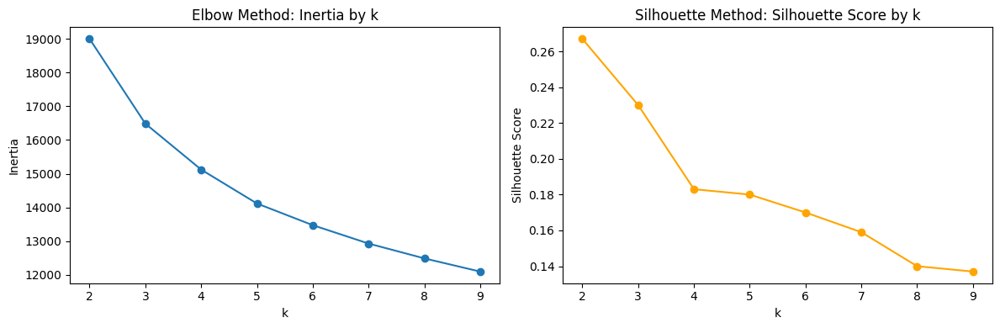

# Methodology

The modelling detail behind the [README](../README.md). The full working, with every plot and correlation table, is in [`notebooks/Analysis_Model.ipynb`](../notebooks/Analysis_Model.ipynb).

## Data and cleaning

[Customer Personality Analysis](https://www.kaggle.com/datasets/imakash3011/customer-personality-analysis)
(`data/customer_segmentation.csv`) — 2,240 customers of a retail company,
one row per customer, 29 columns:

- **Demographics**: birth year, education, marital status, income, kids/teens at home
- **Behavior**: recency, spend by product category (wine, fruit, meat, fish, sweets, gold), purchases by channel (web, catalog, store), web visits/month
- **Campaign history**: response to 5 past campaigns, complaints

`src/data/loader.py` drops the ~1% of rows with missing `Income` and caps
two known outliers (a handful of implausible birth years, one $666,666
income value) — see `config.AGE_MAX` / `config.INCOME_MAX`. `src/features/engineer.py`
derives `Age`, `Total_Spending`, and `Customer_Tenure`, and assembles the
final `config.FEATURES` set (12 features) that the model actually trains
on. 2,216 of the original 2,240 rows survive cleaning.

## Why these 12 features (and not the rest)

`config.FEATURES = [Age, Income, Recency, Customer_Tenure, Total_Spending,
NumWebPurchases, NumStorePurchases, NumCatalogPurchases, NumWebVisitsMonth,
NumDealsPurchases, Teenhome, Kidhome]`. Everything else in the raw dataset
was considered and dropped for a specific reason, not by accident — see the
"Feature Selection" section in the notebook (grouped by theme: demographics,
monetary value, recency/tenure, purchase channel, promotion responsiveness)
for the correlation numbers behind these calls:

- **`TotalNo_Children`** (engineered from `Kidhome` + `Teenhome`) — blends
  `Kidhome`'s real signal with `Teenhome`'s near-neutral one, diluting
  rather than combining. `Kidhome` and `Teenhome` are kept individually
  instead — each earns its place separately via a paired silhouette check,
  not by mechanical correlation cutoff.
- **`Avg_Spend_Per_Purchase`** (engineered: `Total_Spending` / total
  purchases) — r ≈ 0.93 with `Total_Spending`, the strongest pairwise
  correlation in the candidate pool, and its broader correlation profile is
  essentially `Total_Spending`'s restated at a different scale. A rescaling,
  not a new axis.
- **`AcceptedCmp1`–`5` and `Response`** (aggregated into
  `Total_Campaigns_Accepted`) — these record how customers reacted to
  *past* campaigns. Using them to build segments that then drive *future*
  targeting would leak old targeting decisions into new ones.
- **`Complain`** — 21 of 2,216 rows are 1; near-zero variance, contributes
  almost nothing to distance-based clustering (even though its correlation
  profile is about as clean as any candidate's).
- **`Education`, `Marital_Status`** — categorical; K-Means needs numeric
  distances. `Marital_Status` has no natural order, so one-hot-encoding is
  the only honest representation, and that would add several low-signal
  dimensions relative to the behavioral/value features already in play.
  `Education` does have a natural order (`Basic` < `2n Cycle` <
  `Graduation` < `Master` < `PhD`), so an ordinal encoding is a legitimate
  option worth reconsidering in a future iteration — it just hasn't been
  added yet.

`NumCatalogPurchases` is the one feature kept *despite* a negative paired
silhouette check (mean Δ -0.0049) — it names a real, distinct shopping
channel on par with web and store, and that business case outweighs the
statistical evidence, the same call already made for `Income`,
`NumStorePurchases`, `NumWebPurchases`, and `Kidhome` elsewhere in that
section.

## Choosing k

`evaluate_k_range()` in `src/models/train.py` scans k = 2–9 (scaler + K-Means,
no PCA). Silhouette peaks at k=2 (0.267) and declines from there, and the
inertia elbow favours k=4. k=2 is too coarse to act on: marketing needs to
tell loyalty/upsell, win-back and channel-specific customers apart. Between
k=4 and k=5, k=5 was chosen because the extra cluster surfaces a distinct
deal-seeking group that k=4 buries inside a larger low-spend segment.

## Experiment A vs. B: adding PCA

Experiment A (`StandardScaler` → `KMeans`, k=5) gave a low silhouette (0.180)
but very high cluster stability (seed ARI 0.992). That combination pointed at
collinearity between the spend/purchase-count features diluting separation
rather than the segments being noise (`Total_Spending` is a sum of the `Mnt*`
columns and correlates with the purchase counts). Experiment B inserts a `PCA`
step (`config.PCA_VARIANCE = 0.90`, 12 features → 8 components) before K-Means.

| | A: no PCA (baseline) | B: PCA, 8 components (selected) |
|---|---:|---:|
| Silhouette (higher is better) | 0.180 | 0.200 |
| Davies-Bouldin (lower is better) | 1.825 | 1.688 |
| Calinski-Harabasz (higher is better) | 489 | 579 |
| Seed-stability ARI, mean / min (seeds 0–4) | 0.992 / 0.986 | 0.998 / 0.995 |
| Bootstrap-stability ARI, mean / min (10 resamples) | 0.946 / 0.918 | 0.948 / 0.922 |

PCA improved separation *and* stability without materially changing who lands
in which segment (ARI 0.962 between A's and B's assignments). Set
`use_pca=False` in `run_training_pipeline()` / `fit_pipeline()` to reproduce the
baseline. Experiment B's values are also written to `models/training_metrics.json`
on every training run; Experiment A's come from the notebook.

A silhouette of 0.200 still means modest, overlapping separation. That is
typical for demographic/behavioral customer data, where segments overlap
rather than form isolated blobs, so the clusters are judged mainly on whether
their profiles are distinct and actionable.

## Segment profiles

Cluster means from `cluster_profile()` (notebook, Cluster Profile section);
names live in `config.CLUSTER_NAMES`, the single source of truth the API and
app read from.

- **0 — High-Value Customers (No Children)** (n=500): highest income (~$78k) and spend (~$1,380), store-heavy, by far the heaviest catalog usage (6.11 purchases vs. 0.5–3.6 elsewhere), almost no children.
- **1 — Premium Teen-Family Shoppers (Store-Focused)** (n=520): older (62), high income (~$62k) and spend (~$885), the strongest web buyers, almost entirely teen households.
- **2 — Deal-Seeking Large Families** (n=198): mid income/spend (~$48k / ~$490), by far the heaviest deal usage (6.44 deal purchases vs. ~1–3 elsewhere), large families.
- **3 — Low-Income Young Families (Browsing, Not Buying)** (n=544): youngest (47), lowest income (~$29k) and spend (~$93), highest web-visit rate (6.97/month) but few web purchases.
- **4 — Budget Multi-Child Households** (n=454): oldest (63), low income (~$41k) and spend (~$104), the largest households overall.

`Recency` and `Customer_Tenure` are nearly flat across all five clusters, so
"inactive" is not a trait of any one segment: win-back campaigns should filter
by `Recency` *within* a segment.
